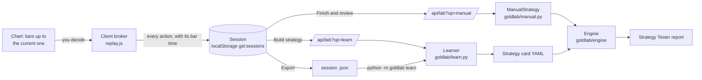
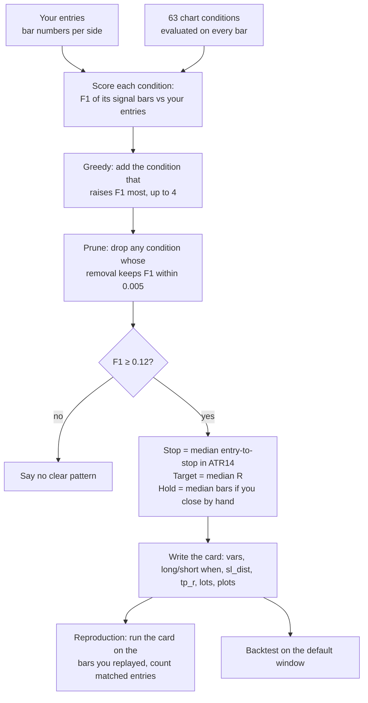

# How recording works: bar replay → session → review → strategy

This is the design of the "record what I do, then make it a strategy" feature. It covers the
browser side (`web/replay.js`, `web/draw.js`, `web/indicators.js`, `web/app.js`), the API
(`goldlab/webapi.py`), the engine adapter (`goldlab/manual.py`) and the learner (`goldlab/learn.py`).

**The one-sentence version:** the browser shows you the past one bar at a time, records every decision
you make with the exact bar it was made on, simulates fills with the same rules as the backtester so the
numbers you see are real, and then hands the decision list to the server, which replays it through the
real engine for the report and searches for the chart conditions your entries had in common.



## 1. The pieces

| Piece | File | Job |
|---|---|---|
| Bars API | `goldlab/webapi.py` `op_bars` | Raw bars for a time window at full precision, plus swap rollovers, in the compact `gsl1` format. Optionally the selected strategy's plotted lines for those bars. |
| Replay UI and client broker | `web/replay.js` | Hides the future, steps, takes orders, fills them like the engine would, records everything, saves sessions, drives review and learning. |
| Shared chart state | `web/app.js` (`window.GSL`) | Bars on the chart, time ↔ bar-index mapping, result rendering, locking of the backtest controls. |
| Drawings and order lines | `web/draw.js` | Draggable stop and target lines during replay (and the drawing tools). |
| Indicators | `web/indicators.js`, `web/ta.js` | Indicator values on the visible bars only; `ta.js` mirrors `goldlab/indicators.py` exactly. |
| Review | `goldlab/webapi.py` `op_manual`, `goldlab/manual.py` | Re-runs the recorded decisions through the engine. |
| Learner | `goldlab/webapi.py` `op_learn`, `goldlab/learn.py` | Turns entries into a strategy card and measures how well it reproduces them. |
| Command line | `python -m goldlab learn session.json` | Same learner, from an exported session file. |

## 2. Starting a replay

1. You press **Replay** and choose a start (a date, a random date, or a click on a candle). The start is
   normalised to a bar: the first bar at or after the chosen time.
2. The browser snapshots the **cost model** in force at that moment from the Settings panel
   (`captureSettings`): preset (realistic or TradingView), account size, commission per lot per side,
   slippage ticks, spread mode (data / fixed / none), swap long and short, in-bar path rule
   (TradingView or pessimistic), margin requirement. These are stored in the session so a session reviewed
   next week uses the costs it was traded with, not whatever Settings says then.
3. It requests bars: `POST /api/lab?op=bars {timeframe, at, before: 1500, after: 3000}`. The response is
   the compact `gsl1` block (section 8) with, per bar, `t, o, h, l, c, v` at 3-decimal precision (exact for
   this data), the bid/ask `sp` spread and `roll` (0, 1 or 3 overnight rollovers crossing that bar, 3 for
   the Wednesday triple charge). When you step past the last loaded bar it fetches the next 3,000.
4. The price chart is replaced with bars `[0 .. index]` only; `GSL.shown` tells the indicators and
   drawings how many bars exist. The selected strategy's plotted lines are emptied (they were computed on
   the full history and would show the future) and its trade markers are hidden. The backtest controls are
   locked; on phones the toolbar and result strip are hidden and a trade bar is pinned to the bottom.
5. A session record is created (section 5) and saved immediately.

## 3. Stepping and the client broker

Every **Next bar** (→ key, or Play at 1/3/10 bars per second) reveals bar `cur + 1` and runs
`processBar(j)` *before* you can act on it, in this order, which is the order the engine uses:

```mermaid
sequenceDiagram
  participant U as You
  participant R as replay.js
  participant E as Engine rules (mirrored)
  U->>R: Next bar
  R->>E: processBar(j)
  E->>E: 1. swap: roll[j] × rate × lots (if a position is open)
  E->>E: 2. gap: does the open already satisfy a stop/target? fill at the open
  E->>E: 3. path: open → nearer extreme → other extreme → close; first trigger touched fills
  E-->>R: position closed (or not)
  R->>R: reveal bar j on the chart; update indicators; redraw order lines
  R-->>U: time, bid/ask, open P&L, balance
```

The rules mirrored from `goldlab/engine/broker.py`:

* **Prices are bids.** Buying pays the ask (`close + spread`) plus slippage; selling receives the bid minus
  slippage. Slippage is `slippage_ticks × $0.01` on market and stop fills, never on target (limit) fills.
* **Orders act at the bar's close.** You see a closed bar and decide; the fill is at that close (the engine's
  `process_orders_on_close=True`). This is the honest model for bar-by-bar trading: you cannot trade inside
  a bar you have not seen.
* **Stops and targets** are watched along TradingView's assumed in-bar path: if the high is nearer the open
  than the low, `open → high → low → close`, else `open → low → high → close` (or, with the pessimistic
  setting, the adverse extreme first). The first level the path touches fills. A level already beyond the
  open (a gap) fills at the open. For shorts the comparisons are made on the ask (`bid + spread`), because
  a short's stop and target are buys.
* **Swap** is charged when a bar crosses the 17:00 New York roll with a position open; Wednesday's roll is
  charged three times.
* **Margin**: an order is refused if `lots × 100 × price × margin% > balance`.
* **Sizing**: lots directly, or *risk % of balance*, where
  `lots = floor(balance × risk% / (stop distance × 100 oz) × 100) / 100`, minimum 0.01.

Two things the client does not model, so a review can differ from what you saw: the engine's margin
*stop-out* (it force-closes at 50% margin level on an extreme bar) and its margin *reduction* of an order
that is too big for free margin at the fill. Both only happen with very large positions.

## 4. What gets recorded

Every action is stored with the time of the bar it was made on, which is what makes the review exact: the
server does not need prices from the browser, only *when* you did *what*.

**Opening** (`openPos`) creates the live position and logs a `buy`/`sell` event:

```json
{"id": "M3", "side": "long", "lots": 0.1, "entry_time": 1748822400, "entry_price": 3311.19,
 "sl": 3279.9, "tp": 3373.8, "init_sl": 3279.9, "init_tp": 3373.8, "note": "pullback to the 20 EMA", "mods": []}
```

**Changing the stop or target** (dragging the line on the chart, or the form) validates the new level
against the current bid/ask (a long's stop must be below the bid, its target above) and appends to `mods`:
`{"time": <bar>, "sl": 3290.0, "tp": 3373.8}`. The original levels stay in `init_sl` / `init_tp`, so R
multiples are measured against the risk you accepted at entry.

**Closing** (a stop or target hit inside `processBar`, or **Close** / Shift+C at a bar's close) turns the
position into a trade record:

| Field | Meaning |
|---|---|
| `id` | `M1`, `M2`, … in order of entry |
| `side`, `lots` | as placed |
| `entry_time`, `entry_price` | bar time (unix seconds) and the actual fill, costs included |
| `sl`, `tp` | the **initial** stop and target (what the engine attaches at fill) |
| `final_sl`, `final_tp` | levels in force at the exit |
| `exit_time`, `exit_price`, `exit_by` | `SL`, `TP` or `Close` |
| `pnl` | gross P&L minus both commissions (swap is kept per session in `swap`) |
| `r` | `pnl ÷ (|entry − init_sl| × ounces)`, or `null` with no stop |
| `bars` | bars held |
| `note` | what you typed in "Why this trade?" |
| `mods` | every stop/target change with its bar time |

The session also keeps an `events` list (buy, sell, modify, close with time; capped at 2,000) for
future "replay my replay" use; nothing reads it yet.

## 5. The session record and where it lives

```json
{
  "format": "goldlab-replay-session", "version": 1,
  "id": "smfx2ab1", "name": "Replay 4h from 2025-06-02", "created": "2026-10-27T09:12:44Z",
  "timeframe": "4h", "preset": "realistic", "settings": {"initial_capital": 10000, "qty_type": "lots", ...},
  "start_time": 1748822400, "current_time": 1749254400,
  "trades": [ ... ], "position": null, "swap": -4.0, "events": [ ... ]
}
```

* Saved to `localStorage["gsl:sessions"]` after **every** action, so closing the tab loses nothing. The
  newest 60 sessions are kept. `position` holds the open trade (with its mods) so **Resume** restores it.
* `current_time` is the bar you stopped on. Resume reloads bars around it and continues; the "seen" range
  `[start_time, current_time]` is what the learner treats as "bars you looked at".
* **Export** writes exactly this object as a `.json` file; **Import** accepts it back (the `format` field is
  checked, a new `id` is assigned). The same file feeds `python -m goldlab learn`.
* Nothing leaves the browser until you press Finish and review or Build strategy; then only the trade
  list (times, sizes, levels, notes) is sent. There are no accounts and no server-side storage.

## 6. Review: the engine re-runs your decisions

`Finish and review` sends `POST /api/lab?op=manual`:

```json
{"timeframe": "4h", "preset": "realistic", "settings": {...}, "start_time": ..., "end_time": ...,
 "trades": [{"side": "long", "lots": 0.1, "entry_time": ..., "entry_price": ..., "sl": ..., "tp": ...,
             "exit_time": null | <bar time if closed by hand>, "exit_by": "TP", "note": "...", "mods": [...]}]}
```

`exit_time` is sent only for trades you closed by hand. Stop and target exits are *not* sent as exits:
the engine finds them itself, which is the point of the review.

Server side (`goldlab/manual.py`):

1. `clean_trades` validates everything (sides, 0.01–100 lots, positive prices, at most 500 trades and 60
   modifications each) and returns `ApiError` → HTTP 400 with a plain message on anything odd.
2. Every time must land exactly on a bar of that timeframe, or the request is refused
   ("… is not a bar on this timeframe"). This catches a session replayed on the wrong timeframe.
3. `ManualStrategy` is a normal `Strategy` subclass. In `init` it indexes the actions by bar number; in
   `next(i)` it replays them in the order *modify → close → open*, calling the same `entry` / `exit` /
   `close_position` API every strategy card uses: `entry(id, side, lots=, sl=, tp=, comment=note)`.
4. The run uses the session's settings with `process_orders_on_close = True` and `pyramiding = 1`, so a
   market order fills at that bar's close with spread and slippage, and brackets attach at the fill. From
   then on the engine's own path walking, swap and margin apply.
5. The result goes through the same `_payload` as a backtest, so the Overview, Performance, Analysis,
   Trades and Monthly tabs work unchanged; `strategy.manual = true` tells the page to show the replay notice
   and the report card.

**Parity is tested**, not assumed: `tests/e2e/run.cjs` places buys, sells, stop moves and hand closes in
the browser and asserts that every server trade matches the browser's entry price, exit price, exit time,
exit kind and P&L (to $0.0001). `tests/test_replay.py` checks the server side against hand calculations.

## 7. Learning: from entries to a strategy card

`Build strategy` sends `POST /api/lab?op=learn {timeframe, trades, seen: [[start, end], ...], name}`.
Several sessions on the same timeframe can be combined (the sessions dialog offers it).



Details that matter:

* **Conditions** (`learn.CONDITIONS`) are strategy-card expressions, so anything the learner picks is
  something the backtester can run: trend (price vs EMA 20/50/200, EMA stack, Supertrend, ADX),
  momentum (RSI bands, MACD sign), location (near an EMA, outside Bollinger Bands, volatility regime),
  events (crosses, 20/55-bar breakouts, RSI and MACD crosses, Supertrend flips), candle patterns (engulfing,
  hammer, shooting star, close beyond the previous bar), and on intraday timeframes the sessions and the
  Asian-range breakout. State conditions (true for a stretch) and event conditions (true on one bar) are
  both reduced to *rising edges*, so "price above the 200 EMA" means "the moment the setup became true".
* **Eligible bars** are the bars you actually looked at while flat: the seen ranges minus the bars inside
  your trades. A condition is not penalised for firing while you were already in a trade.
* **Scoring** uses F1 with a timing tolerance: an entry counts as reproduced if a signal fires 0–3 bars
  before it or 1 bar after (people react a bar late; a card reacts on the signal bar).
* **Per side**: longs and shorts are learned separately; a side needs at least 3 trades (10+ works much
  better). Sides without a pattern are left out of the card with a note saying why.
* **Stop and target** come from *your* trades: the median stop distance in ATR(14) at entry (rounded to
  0.25, default 1.5 if you never set stops) and the median target in R (only if at least half the trades
  had targets). If you mostly closed by hand, the median hold becomes `exit.max_bars`.
* **The card** is ordinary YAML: `vars.long_setup` is the AND of the chosen conditions; `long.when` is
  `long_setup and not long_setup[1]`; `sl_dist: long_sl_atr * atr(14)`; `tp_r: long_tp_r`; sizing is your
  median lots; EMAs/SMAs used by the conditions are added as `plots`. It opens in the Rules editor so you
  can change anything.
* **Honesty checks** are shown with it: how many of your entries the card repeats on the replayed bars
  (and how many trades it took there), and its backtest on the default data window. A card that repeats
  your entries but loses money is telling you something about the entries.

## 8. Performance design

* **Compact chart data** (`gsl1`): integer deltas instead of floats. Times are `[t0, Δt, Δt, …]`; prices
  are scaled to integers (×100 for charts, ×1000 for replay bars so fills are exact) with close as deltas
  and open/high/low relative to the bar's close. A 3,000-bar window is ~110 KB raw / ~25 KB after
  brotli; the old float rows were 1.3 MB raw / 434 KB for 12,000 bars. `pack_bars` / `unpack_bars` in
  `webapi.py` and `GSL.unpackBars` in `app.js` are the two ends; a test round-trips the data exactly.
* **Windowed history**: a backtest result carries the last 3,000 bars. Scrolling to the left edge loads the
  previous 3,000 (with the strategy's plotted lines for them, warmed up on 1,500 earlier bars) and
  prepends them without moving the view; picking a trade older than the chart loads back to it.
* **Service worker** (`web/sw.js`): the chart library and fonts (versioned URLs) are served from cache on
  repeat visits; the site's own files are network-first with a cached fallback, so they are always fresh
  online and still open offline. The API is never cached except the strategy list.
* **Indicators and fills run in the browser** during replay, so stepping costs no network round trip;
  the server is called once to start, once per 3,000 bars, once to review, once to learn.

## 9. Failure modes and what happens

| Situation | Behaviour |
|---|---|
| Tab closed or phone locked mid-session | Session is saved after every action; **My sessions → Resume** continues at the same bar with the open position. |
| Start date with no bars after it | 400 from `bars` with a message; you stay on the date picker. |
| End of the data while stepping | Play pauses; a toast says the data ends there. |
| A trade's time is not a bar on the timeframe (e.g. imported from another timeframe) | Review refuses with "… is not a bar on this timeframe". |
| Too many trades / modifications / bars | 400 with the limit named (500 trades, 60 mods, 150,000 bars). |
| Server unreachable during review or learn | Toast with the error; the session stays saved; try again later. |
| Session file from the future | `format` must be `goldlab-replay-session`; unknown fields are ignored. |
| Fewer than 3 trades per side | Learner says so instead of guessing. |
| No clear pattern | Learner says so; the page suggests notes and more trades. |
| Offline on a repeat visit | Shell and chart library open from the worker's cache; the API (and so new backtests) need the network. |

## 10. Tests that pin this down

| Test | Where |
|---|---|
| Engine fills at the bar close pay spread and slippage; exit kinds are recorded | `tests/test_replay.py` |
| Bars API is exact, continues, and refuses bad timeframes/times | `tests/test_replay.py` |
| Manual review matches a hand calculation; stop moves apply; bad input is refused | `tests/test_replay.py` |
| Learner recovers a hidden rule exactly; needs enough trades; finds nothing in random entries | `tests/test_replay.py` |
| `python -m goldlab learn` writes a card from an exported session | `tests/test_replay.py` |
| Compact format round-trips exactly; history bars join the first result | `tests/test_webapi.py` |
| Browser fills match the server trade for trade | `tests/e2e/run.cjs` "replay: buy, sell, stops, targets…" |
| Hidden future, stepping, locking, phone bar, ticket sheet, risk sizing, presets, coach, report card, journal, sessions export/import/resume, learning dialog | `tests/e2e/run.cjs` |
| Payload budget, history on scroll, service-worker caching on the live site | `tests/e2e/run.cjs` "speed: …" |

## 11. Extending it

* **A new chart condition**: add a `Cond(key, label, expr, kind, intraday)` to `learn.CONDITIONS`. The
  expression must be valid strategy-card syntax, which also makes it exportable to Pine.
* **A new field on a trade**: add it in `closePos` (browser), `clean_trades` (validation) and, if the
  engine needs it, `ManualStrategy.next`. Keep `format`/`version` in the session so old files still load.
* **Another order type** (limit or stop entries in replay): the engine already supports them
  (`entry(..., stop=, limit=)`); the client broker's `triggers()` would need entry triggers like the
  engine's `_triggers`, and the parity test would need a case for them.
